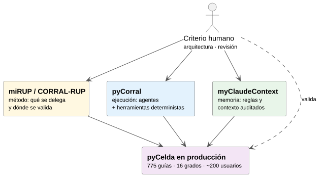

# De construir software a gobernar el proceso (y a enseñar a hacerlo)

Desde 1998 me hago la misma pregunta con herramientas distintas: ¿qué parte de construir un sistema se puede delegar y cuál no? Primero se la hice a compiladores y librerías; hoy, a agentes de IA. La respuesta no ha cambiado: **la ejecución se delega; la arquitectura, la trazabilidad del proceso y el criterio técnico, no.** Lo que sigue es la evidencia.

## 1. Los cimientos: algoritmos, sistemas de dominio y reingeniería (1998 – actualidad)

Empecé por los datos y las reglas, no por la tecnología de moda. Tiene una ventaja práctica: la moda caduca y el modelo, si está bien hecho, sigue ahí.

* **[SIGHOR / pySigHor](https://github.com/mmasias/pySigHor) (1998 – actualidad):** Nació en **Visual Basic 3.0** (Universidad de Piura) aplicando Investigación de Operaciones a los horarios académicos. Hoy es un laboratorio de reingeniería: 32 casos de uso analizados en RUP, independientes del stack y planteados para cuatro arquitecturas (*FastAPI+React*, *Spring+Angular*, *CLI sobre API*, *CLI standalone*), y más de 50 sesiones humano-IA documentadas.
* **[NutrIber](https://www.funiber.org/proyectos/idi/mejora-del-actual-software-piloto-nutriber-barcelona-espana-2007-2008) (2003):** Hecho en **Visual Basic 6.0** para FUNIBER (nutrición y antropometría). Se sigue usando hoy: su estructura de datos aguanta más de veinte años después; el VB6, por razones obvias, no tanto. Hacia 2020 una clienta reportó un fallo que no aparecía por ningún lado; con su base de datos delante, la causa resultó ser que acababa de crear su receta número 32.768 en una tabla con clave `Integer` de 16 bits. Quince años de uso hasta agotar el tipo de dato.
* **[QualityCourses / pyQualityCourses](https://github.com/mmasias/pyQualityCourses) (2007):** CMS multilingüe (8 idiomas) en PHP 4/5 y MySQL, con *Front Controller* y *TemplatePower*. Hoy está dockerizado y sirve de caso de estudio de modernización *legacy*.

Tres sistemas, tres stacks ya caducados; los modelos de datos, no. El stack cambia; el dominio, si se entendió bien, no.

## 2. Arquitectura institucional: ecosistemas de dominio

Un sistema bien modelado es útil. Varios que se hablan sin pisarse son una institución.

* **[pyCelda](https://github.com/mmasias/pyCeldaPublico) y [Ecosistema CELDA](https://github.com/mmasias/_ECOSISTEMA_CELDA):** Cada dato y cada regla tienen un único dueño. CELDA gestiona las guías docentes y se conecta con 10 satélites independientes de planificación (`SIGHOR`, `CARGA`, `ASISTE`, `ACTIVITAT`) y de calidad y difusión (`MERITOS`, `PRISMA`, `PULSO`, `VITRINA`, `CITA`, `FEDATARIO`).
* **pyCelda en producción:** desde el curso 2026-27 gestiona 775 guías docentes de 16 grados con unos 200 usuarios. Se construyó con las tres capas de la sección siguiente: 9 días de requisitos con agentes, 3 días hasta la primera versión completamente funcional, 65 versiones desplegadas y 1.140 tests. Lo [presenté en el Cluster TIC de Cantabria](https://docs.google.com/presentation/d/1VuHlfe55VGxMGAGXUOPhQvlG3Bc5NyizQQwmDEHSXAM/present).

## 3. Arquitectura para la era de los agentes: memoria, ejecución y método

Con los LLMs el reto cambió de escala, no de naturaleza: orquestar herramientas heterogéneas sin perder control ni trazabilidad. Lo resuelvo en tres capas complementarias.

### A. Identidad y memoria auditada: [`myClaudeContext-template`](https://github.com/mmasias/myClaudeContext-template)
* Sin dependencias externas (solo `git` y *symlinks*): unifica las reglas de los asistentes de terminal bajo una única fuente de verdad, con *commits* y etiquetas recuperables.

### B. Orquestación agnóstica de agentes: [`pyCorral`](https://github.com/mmasias/pyCorral)
* Un servidor MCP (*Model Context Protocol*) que usa el sistema de ficheros como bus de datos y separa el *Plano de Control* del *Plano de Datos*, para combinar LLMs con herramientas deterministas.

### C. Proceso sobre producto: [`miRUP`](https://github.com/mmasias/mirup) y [`CORRAL-RUP`](https://github.com/mmasias/pyCorral/discussions/3)
* Recupera el rigor de RUP como contrato de delegabilidad: separa el espacio de proceso del de entregables validados, con *milestones* de validación humana obligatoria.

Las tres capas no sustituyen la revisión humana, la hacen posible. En pyCelda, un compañero encontró un fallo de autorización (un IDOR: cualquier director de grado podía leer datos de un grado ajeno cambiando un identificador en la URL) que el desarrollo con agentes había dejado pasar; quedó corregido en dos días. Y los errores de los agentes no se esconden: tienen su propio registro, un chiste de una línea por cada metedura de pata, que ya pasa de la docena.

## 4. Traslado al aula: responsabilidad técnica frente a la delegación ciega

Como profesor en la **Universidad Europea del Atlántico ([UNEATLANTICO](https://www.uneatlantico.es))**, aplico a quienes serán ingenieros lo mismo que exijo al software:

* **[Política de uso transparente de IA](https://github.com/mmasias/mmasias/blob/main/docs/UNEATLANTICO/2Think.md):** se evalúa que el estudiante comprenda, defienda y sepa modificar en vivo el código que entrega.
* **[Evaluación basada en trazabilidad](https://github.com/mmasias/26-27-prg1/discussions/208):** el flujo de Git (fork, commits con formato, pull request al repositorio correcto) se evalúa igual que el código, también en los exámenes.

## #2Think

El hilo desde **1998 hasta hoy** es la separación entre **ejecución y responsabilidad**:
1. **La ejecución es delegable** (en compiladores, librerías o agentes orquestados).
2. **La arquitectura, la trazabilidad del proceso y el criterio técnico son indelegables.**

Delegar sin criterio no es ingeniería: es hechicería con mejor documentación.

Actualizado: noviembre de 2026
